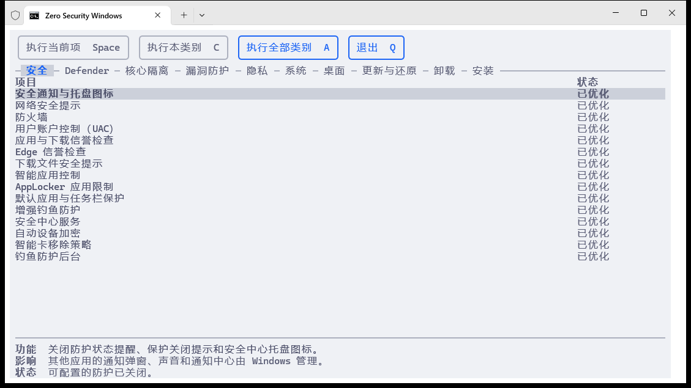

# Zero Security Windows

**更轻、更纯净的 Windows。**

Zero Security Windows 是一款以精简与性能为优先的开源 Windows 优化工具。它深入系统的防护与后台机制，减少资源占用、数据收集和软件运行干预，为工作、开发与游戏营造更简洁的系统环境。

[下载最新版](https://github.com/tkkcc/zero_security_windows/releases/latest/download/zero_security_windows.exe) · [反馈问题](https://github.com/tkkcc/zero_security_windows/issues)

## 产品特色

- **性能优先，精简深入系统**：从 Defender、虚拟化安全到漏洞缓解，处理常规设置之外的防护开销与软件运行限制。
- **深度调整，自动接续完成**：自动进入安全模式完成 Defender 深度禁用，返回正常模式后继续执行，省去手动切换环境的繁琐。
- **日常环境，减少后台干扰**：精简预装内容、诊断收集与后台活动，减少系统推荐和推广，让桌面更清爽、系统更安静。
- **一键恢复默认配置**：每个项目都可按 `R` 恢复 Windows 默认可用配置，包括 Defender、安全设置和应用安装。恢复安装项会卸载应用；恢复精简项会重新安装应用。
- **运行环境独立**：没有 Windows Terminal 也能使用系统控制台打开；SysMain 总服务与预读、内存压缩、页面合并可分别调整。

管理员身份运行下载的可执行文件。`Space` 执行当前项，`C` 执行当前类别，`A` 执行全部，`R` 恢复当前项，`F10` 在需要时重启，`Q` 退出。

默认禁用整个 SysMain；三个子项需单独执行，执行子项会启用总服务。预装应用卸载并清除预配，移除用户可见注册；有可靠 winget 源的应用不保留安装文件，按 `R` 联网重装。没有安装源的组件只保存必要恢复材料。卸载可能移除应用数据，缓存入口在重新登录后刷新。恢复材料与桌面清理内容保存在 `%ProgramData%\ZeroSecurityWindows\recovery`。

[开发文档](docs/development.md) · [MIT 许可证](LICENSE)
